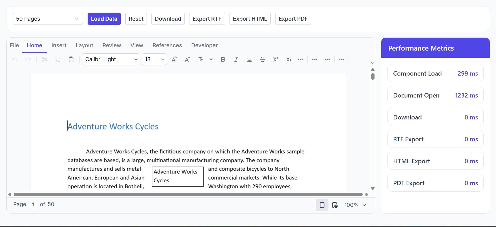

# Syncfusion® React DOCX Editor – Performance Benchmark Sample

## Introduction

This sample demonstrates performance benchmarking scenarios using the Syncfusion® React DOCX Editor. It enables users to load benchmark documents of various sizes and measure key operations such as component initialization, document loading, document download, and export operations.

## Project Features

- Load predefined benchmark documents (50, 100, 200, and 500 pages).
- Measure component initialization performance.
- Measure document opening performance.
- Measure DOCX download performance.
- Measure RTF, HTML, and PDF export performance.
- View benchmark metrics directly within the application.

## Demo



## How to Run the Sample

This sample consists of a React client application and an ASP.NET Core backend service. Both applications must be running.

### 1. Start the ASP.NET Core backend

Navigate to the server project directory and run:

```bash
dotnet run
```

### 2. Configure the service URL

Update the Document Editor service URL in:

```text
src/App.tsx
```

Example:

```text
http://localhost:<your-port>/api/documenteditor/
```

### 3. Install client dependencies

Navigate to the React project directory and run:

```bash
npm install
```

### 4. Start the React client

```bash
npm start
```

### 5. Open the application

Open the URL displayed in the terminal after the application starts.

## APIs Used

| API / Endpoint | HTTP Method | Purpose |
|---|---|---|
| `/api/documenteditor/LoadBenchmarkDocument` | POST | Loads benchmark documents and returns SFDT content. |
| `/api/documenteditor/BenchmarkRtf` | POST | Measures and performs RTF export operations. |
| `/api/documenteditor/BenchmarkHtml` | POST | Measures and performs HTML export operations. |
| `/api/documenteditor/BenchmarkPdf` | POST | Measures and performs PDF export operations. |

# Resources

- **Product page:** Syncfusion® React DOCX Editor
- **Documentation:** Syncfusion® React DOCX Editor - Documentation
- **Online demo:** Syncfusion® React DOCX Editor - Online demo

# Support and feedback

For any other queries, reach our Syncfusion® support team or post the queries through the community forums.

Request new feature through Syncfusion® feedback portal.

# License

This is a commercial product and requires a paid license for possession or use. Syncfusion's licensed software, including this component, is subject to the terms and conditions of Syncfusion's EULA. You can purchase a license here or start a free 30-day trial here.